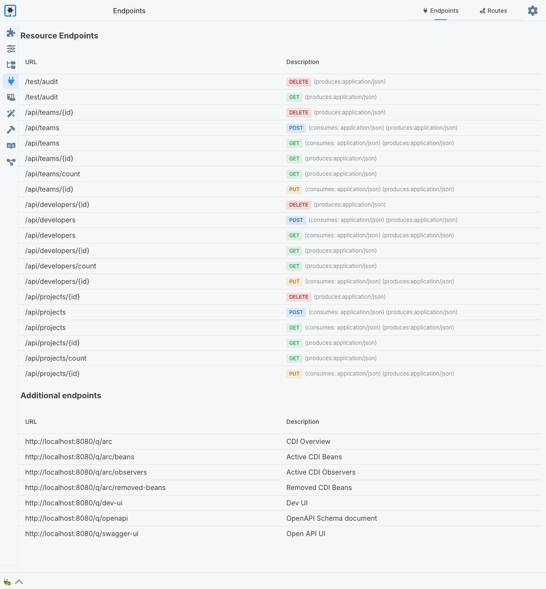

# Quarkus Queryable Tutorial

A complete, runnable example of the [Quarkus Queryable](https://github.com/queryabledev/quarkus-queryable)
extension (version **4.0.1**), following the tutorial at
[queryable.dev/quarkus-extension.html](https://queryable.dev/quarkus-extension.html).

Queryable is a Quarkus extension that adds annotation-driven collection filters to
Hibernate ORM REST Data with Panache. Standard CRUD, count, OpenAPI and transaction
handling are generated by `quarkus-hibernate-orm-rest-data-panache`; Queryable
contributes the collection `GET` endpoint and its richer query language.

This project demonstrates:

- annotation-driven filters (`@Q`, `@QLike`, `@QList`, `@QLikeList`, `@QNil`, `@QNotNil`, `@QLogicalDelete`, `@QOrderBy`)
- Hibernate filters with SQL subqueries connected to REST parameters (`@QFilter`, new in 4.0.1)
- custom filter contributors (`QueryableFilter`)
- REST lifecycle callbacks (`QueryableRsListener` with `@PrePersist`, `@PreUpdate`, `@PostPersist`, `@PostUpdate`, `@PostDelete`)
- validation of creates and updates in lifecycle callbacks using REST exceptions (new in 4.0.1)
- security via standard Quarkus configuration
- generated OpenAPI documentation
- a full REST Assured test suite

## What's new in 4.0.1

- Connect REST parameters to existing Hibernate filters, including SQL
  subqueries, with `@QFilter` (the classic `@FilterDef` technique).
- The entity type is inferred from the `QueryableFilter<T>` and
  `QueryableRsListener<T>` generics — no more `entityType()` override.
- Validate creates and updates in lifecycle callbacks by throwing Jakarta REST
  exceptions (e.g. `BadRequestException` → HTTP 400).

Known limitation: `QOption.EXECUTE_ALWAYS` and `WITHOUT_PARAMETERS` are not
applied by this extension.

## Prerequisites

- Java 21+
- Maven 3.9+ (or the included `./mvnw` wrapper)
- the `dev.queryable:quarkus-queryable:4.0.1` extension (available on Maven Central)

## Step 1 — Scaffold the project

The project skeleton was generated with the Quarkus Maven plugin:

```bash
mvn io.quarkus.platform:quarkus-maven-plugin:3.40.1.2:create \
    -DprojectGroupId=dev.queryable.tutorial \
    -DprojectArtifactId=quarkus-queryable-tutorial \
    -DnoCode
```

This creates the Maven wrapper, the `pom.xml` with the Quarkus BOM
(`io.quarkus.platform:quarkus-bom:3.40.1.2`), Dockerfiles and an empty
`src/main/resources/application.properties`.

## Step 2 — Add the dependencies

Add the Queryable extension and its companions to [`pom.xml`](pom.xml):

```xml
<dependency>
    <groupId>dev.queryable</groupId>
    <artifactId>quarkus-queryable</artifactId>
    <version>4.0.1</version>
</dependency>
<!-- JSON serialization -->
<dependency>
    <groupId>io.quarkus</groupId>
    <artifactId>quarkus-rest-jackson</artifactId>
</dependency>
<!-- Panache entities -->
<dependency>
    <groupId>io.quarkus</groupId>
    <artifactId>quarkus-hibernate-orm-panache</artifactId>
</dependency>
<!-- JDBC driver: H2 in-memory for the tutorial, use your own in production -->
<dependency>
    <groupId>io.quarkus</groupId>
    <artifactId>quarkus-jdbc-h2</artifactId>
</dependency>
<!-- BASIC auth with embedded users (tutorial only) -->
<dependency>
    <groupId>io.quarkus</groupId>
    <artifactId>quarkus-elytron-security-properties-file</artifactId>
</dependency>
<!-- OpenAPI / Swagger UI -->
<dependency>
    <groupId>io.quarkus</groupId>
    <artifactId>quarkus-smallrye-openapi</artifactId>
</dependency>
```

Test dependencies: `io.quarkus:quarkus-junit` and `io.rest-assured:rest-assured`.

## Step 3 — Annotate the entities

Entities live in [`src/main/java/dev/queryable/tutorial/model`](src/main/java/dev/queryable/tutorial/model):
[`Developer`](src/main/java/dev/queryable/tutorial/model/Developer.java),
[`Team`](src/main/java/dev/queryable/tutorial/model/Team.java) and
[`Project`](src/main/java/dev/queryable/tutorial/model/Project.java).
`@QRs` marks an entity as a REST resource; Quarkus generates the endpoints at
build time (augmentation + Gizmo bytecode) — no REST source files appear in the
application.

The central entity of the tutorial is `Developer`:

```java
@Entity
@Table(name = "developers")
@QRs("/api/developers")
@QOrderBy("surname asc")
public class Developer extends PanacheEntityBase {

    @UuidGenerator
    @Id
    @QList
    public String uuid;

    @QLike
    public String name;

    @QLike
    public String surname;

    @QList
    public String team_uuid;

    @Q
    public LocalDate hiredOn;

    @QNil
    @QNotNil(prefix = "notNil")
    public String notes;

    @QLogicalDelete
    public boolean active = true;
}
```

The annotation matrix, with the query parameters it enables on
`GET /api/developers` (and `GET /api/teams` for `@QLikeList`):

| Annotation | Query parameter | Semantics |
|---|---|---|
| `@QLike` | `like.surname=pi` | case-insensitive `LIKE %…%` |
| `@QLikeList` | `like.tags=react,java` | `LIKE` over comma-separated values |
| `@Q` | `obj.hiredOn=…`, `from.hiredOn=…`, `to.hiredOn=…` | equality and range filters |
| `@QList` | `obj.team_uuid=team-1,team-2` | `IN (…)` |
| `@QNil` | `nil.notes=1` | `IS NOT NULL` (legacy Queryable semantics) |
| `@QNotNil(prefix = "notNil")` | `notNil.notes=1` | `IS NULL` (legacy Queryable semantics) |
| `@QLogicalDelete` | `obj.active=false` | logical delete flag, defaults to active records |
| `@QOrderBy("surname asc")` | `orderBy=name desc` | default and per-request sorting |

Pagination is built in: `pageSize` and `startRow` query parameters, with
`listSize` and `pageSize` response headers.

## Step 4 — Custom filter contributor

Filters beyond the annotation matrix go in `service/filters` as CDI beans
implementing `QueryableFilter<T>`. See
[`DeveloperFilter`](src/main/java/dev/queryable/tutorial/service/filters/DeveloperFilter.java),
which adds a `search` parameter matching name **or** surname — an `OR` across
fields that annotations cannot express:

```java
@ApplicationScoped
public class DeveloperFilter implements QueryableFilter<Developer> {

    @Override
    public void contribute(QueryableFilterContext<Developer> context) {
        String search = context.param("search");
        if (search != null && !search.isBlank()) {
            String pattern = "%" + search.toLowerCase(Locale.ROOT) + "%";
            context.add(context.criteriaBuilder().or(
                    context.criteriaBuilder().like(
                            context.criteriaBuilder().lower(context.root().get("name")), pattern),
                    context.criteriaBuilder().like(
                            context.criteriaBuilder().lower(context.root().get("surname")), pattern)));
        }
    }
}
```

Since 4.0.1 the entity type is inferred from the `QueryableFilter<Developer>`
generic (including through generic superclasses); overriding `entityType()` is
still supported but no longer necessary.

## Step 5 — Hibernate filters with `@QFilter` (4.0.1)

For conditions that are easier to express as SQL — subqueries in particular —
you can keep using the classic Hibernate `@FilterDef`/`@Filter` technique and
connect each filter parameter to a REST query parameter with `@QFilter`
(repeatable).

In this tutorial, `Project` holds its members in an element collection
(`project_developers` table), and `Developer` exposes a `@QFilter` that returns
only the developers assigned to a given project. See
[`Developer`](src/main/java/dev/queryable/tutorial/model/Developer.java):

```java
@Entity
@Table(name = "developers")
@QRs("/api/developers")
@FilterDef(name = "Developer.project",
    parameters = @ParamDef(name = "project_uuid", type = String.class))
@Filter(name = "Developer.project",
    condition = "exists (select 1 from project_developers pd "
        + "where pd.developer_uuid = {developer}.uuid "
        + "and pd.project_uuid = :project_uuid)",
    deduceAliasInjectionPoints = false,
    aliases = @SqlFragmentAlias(alias = "developer", table = "developers"))
@QFilter(name = "Developer.project", queryParam = "obj.project_uuid", filterParam = "project_uuid")
public class Developer extends PanacheEntityBase { … }
```

and the membership side on [`Project`](src/main/java/dev/queryable/tutorial/model/Project.java):

```java
@ElementCollection
@CollectionTable(name = "project_developers", joinColumns = @JoinColumn(name = "project_uuid"))
@Column(name = "developer_uuid")
public List<String> developers_uuid = new ArrayList<>();
```

`GET /api/developers?obj.project_uuid=proj-1` activates the Hibernate filter on
the generated collection endpoint (and on the query that computes the
`listSize` header). Hibernate owns the SQL condition and converts the parameter
values; without the query parameter the filter is not activated.

## Step 6 — REST lifecycle callbacks

Lifecycle callbacks go in `service/listeners` as CDI beans implementing
`QueryableRsListener<T>`. See
[`DeveloperListener`](src/main/java/dev/queryable/tutorial/service/listeners/DeveloperListener.java):

- `@PrePersist` / `@PreUpdate` run **inside** the write transaction — used here
  to validate the entity (name and surname required, throwing
  `BadRequestException` → HTTP 400, new in 4.0.1) and to set the audit fields
  (`creationUser`, `updateUser`, …) from the `SecurityIdentity`;
- `@PostPersist` / `@PostUpdate` / `@PostDelete` are registered as JTA
  synchronizations and run **after a successful commit** — used here to push
  events to the [`AuditSinkService`](src/main/java/dev/queryable/tutorial/service/AuditSinkService.java).

Callbacks support fetch, list, persist, update and delete
(`@PreFetch`, `@PostFetch`, `@PreList`, `@PostList`, `@PreDelete`, …).

The audit trail is exposed for inspection by
[`AuditServiceRs`](src/main/java/dev/queryable/tutorial/service/rs/AuditServiceRs.java)
at `GET /test/audit`.

Since 4.0.1 the listener entity type is also inferred from the
`QueryableRsListener<Developer>` generic.

## Step 7 — Configuration and seed data

[`application.properties`](src/main/resources/application.properties) configures
the H2 in-memory datasource, schema generation, and the embedded test user.
Security remains standard Quarkus configuration — `/api/developers` requires
authentication, while `/api/teams` and `/api/projects` stay open:

```properties
quarkus.http.auth.basic=true
quarkus.http.auth.permission.developers.paths=/api/developers/*
quarkus.http.auth.permission.developers.policy=authenticated
quarkus.http.auth.permission.developers-list.paths=/api/developers
quarkus.http.auth.permission.developers-list.policy=authenticated
```

[`import.sql`](src/main/resources/import.sql) seeds two teams, three developers
(one logically deleted) and two projects with their members at startup.

## Step 8 — Run the tests

[`QueryableTutorialTest`](src/test/java/dev/queryable/tutorial/QueryableTutorialTest.java)
exercises security, the filter matrix, the Hibernate `@QFilter` project
subquery, the custom contributor, team filtering with dynamically created
developers, pagination, lifecycle hooks, validation, OpenAPI and the count
endpoint:

```bash
./mvnw clean test
```

Expected result: `Tests run: 11, Failures: 0, Errors: 0, Skipped: 0`.

## Run in dev mode

```bash
./mvnw quarkus:dev
```

Then try the generated API (user `alice`, password `secret`):

```bash
# collection GET with Queryable filters
curl -u alice:secret 'http://localhost:8080/api/developers?like.surname=pi'
curl -u alice:secret 'http://localhost:8080/api/developers?obj.team_uuid=team-1'
curl -u alice:secret 'http://localhost:8080/api/developers?from.hiredOn=2026-01-01&to.hiredOn=2026-12-31'
curl -u alice:secret 'http://localhost:8080/api/developers?search=ross&orderBy=name desc&pageSize=10'

# Hibernate filter via @QFilter (4.0.1): only the developers of a project
curl -u alice:secret 'http://localhost:8080/api/developers?obj.project_uuid=proj-1'

# standard REST Data Panache endpoints
curl -u alice:secret 'http://localhost:8080/api/developers/count'
curl -u alice:secret 'http://localhost:8080/api/developers/dev-1'

# unsecured tutorial entities
curl 'http://localhost:8080/api/teams?like.tags=react,java'
curl 'http://localhost:8080/api/projects?like.name=query'
```

Swagger UI is available at <http://localhost:8080/q/swagger-ui> and the Dev UI
endpoints overview at <http://localhost:8080/q/dev-ui/endpoints> (see below).

## Generated API

For every `@QRs` entity the extension generates the full CRUD + count + filtered
collection `GET`. These are all the routes exposed by the three entities of this
tutorial:

[`Developer`](src/main/java/dev/queryable/tutorial/model/Developer.java) — `/api/developers` (authenticated):

```text
POST   /api/developers
GET    /api/developers/{id}
PUT    /api/developers/{id}
DELETE /api/developers/{id}
GET    /api/developers/count
GET    /api/developers              ?obj.uuid=&like.name=&like.surname=&obj.team_uuid=
                                    &obj.hiredOn=&from.hiredOn=&to.hiredOn=
                                    &nil.notes=&notNil.notes=&obj.active=
                                    &obj.project_uuid=&search=
                                    &orderBy=&pageSize=&startRow=
```

[`Team`](src/main/java/dev/queryable/tutorial/model/Team.java) — `/api/teams`:

```text
POST   /api/teams
GET    /api/teams/{id}
PUT    /api/teams/{id}
DELETE /api/teams/{id}
GET    /api/teams/count
GET    /api/teams                   ?obj.uuid=&like.name=&like.tags=&orderBy=&pageSize=&startRow=
```

[`Project`](src/main/java/dev/queryable/tutorial/model/Project.java) — `/api/projects`:

```text
POST   /api/projects
GET    /api/projects/{id}
PUT    /api/projects/{id}
DELETE /api/projects/{id}
GET    /api/projects/count
GET    /api/projects                ?obj.uuid=&like.name=&obj.budget=&from.budget=&to.budget=
                                    &orderBy=&pageSize=&startRow=
```

Plus the tutorial-only audit resource ([`AuditServiceRs`](src/main/java/dev/queryable/tutorial/service/rs/AuditServiceRs.java)):

```text
GET    /test/audit
DELETE /test/audit
```

## OpenAPI and Dev UI

All generated routes are documented in OpenAPI (including the Queryable filter
parameters, which appear on the collection `GET` operations):

- OpenAPI schema: <http://localhost:8080/q/openapi>
- Swagger UI: <http://localhost:8080/q/swagger-ui>
- Dev UI endpoints overview: <http://localhost:8080/q/dev-ui/endpoints>

This is the Dev UI endpoints page of this tutorial application in dev mode —
every route above is generated at build time from the annotated entities:



## Project layout

```text
src/main/java/dev/queryable/tutorial/
├── model/                  # @QRs entities: Developer, Team, Project
└── service/
    ├── AuditSinkService.java  # collects post-commit audit events
    ├── filters/            # QueryableFilter contributors
    │   └── DeveloperFilter.java
    ├── listeners/          # QueryableRsListener lifecycle callbacks
    │   └── DeveloperListener.java
    └── rs/                 # plain JAX-RS resources
        └── AuditServiceRs.java
```

## Documentation

- [Getting started](https://github.com/queryabledev/quarkus-queryable#readme)
- [Filters](https://github.com/queryabledev/quarkus-queryable/blob/main/docs/modules/ROOT/pages/filters.adoc)
- [REST lifecycle](https://github.com/queryabledev/quarkus-queryable/blob/main/docs/modules/ROOT/pages/lifecycle.adoc)
- [Security](https://github.com/queryabledev/quarkus-queryable/blob/main/docs/modules/ROOT/pages/security.adoc)
- [Testing real applications](https://github.com/queryabledev/quarkus-queryable/blob/main/docs/modules/ROOT/pages/testing.adoc)
